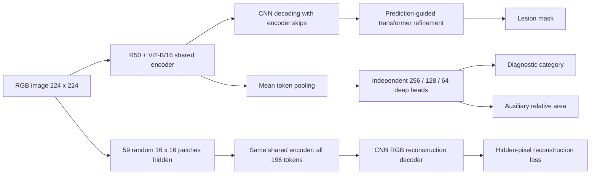

# MSS-Trans-Net

Implementation prepared for [kanwaal/MSS-TransNet](https://github.com/kanwaal/MSS-TransNet)
from the supplied **MSS_Trans_Net_updated.zip** manuscript:

> MSS-Trans-Net: Multitask semi-supervised learning with transformer-based network
> for breast cancer diagnosis in ultrasound scans — Mehreen Kanwal and Yunsik Son.

This release implements the updated manuscript's four-branch model and evaluation
procedure. It is a new implementation of that specification, **not the previous
deeper-head export or a checkpoint release**. No trained/pretrained weights, images,
patient metadata, authentication credentials, or historical result tables are included.
No manuscript performance is claimed for this newly implemented code without training.

## TransUNet 2024 credit and backbone

**The segmentation encoder–decoder is based on TransUNet by Chen et al.** Please
credit and cite their work when using this repository:

Chen et al. (2024), *TransUNet: Rethinking the U-Net architecture design for medical
image segmentation through the lens of transformers*. Medical Image Analysis,
97, 103280. [DOI: 10.1016/j.media.2024.103280](https://doi.org/10.1016/j.media.2024.103280).

* Official 2D implementation: [Beckschen/TransUNet](https://github.com/Beckschen/TransUNet).
  Its R50–ViT-B/16 encoder, CNN upsampling decoder and skip connections are retained.
* Official 2024 query-decoder implementation:
  [Beckschen/3D-TransUNet](https://github.com/Beckschen/3D-TransUNet).
  The packaged masked transformer decoder is a source-derived **2D adaptation**
  retaining their query features/positions, multiscale masked cross-attention,
  self-attention, FFN, normalization and three-layer mask-embedding MLP.
* The authors acknowledge Mask2Former; its attribution and the inherited positional
  encoding notices/licenses are preserved here as well.

The encoder–decoder is credited to TransUNet. The MSS additions are masked
reconstruction, breast diagnosis/area heads, and the two-stage multitask training
procedure. The adaptation does not claim the full volumetric nnU-Net-based model is
unchanged. Exact sources, dimensional changes and numerical parity tests are in
[TRANSUNET_2024.md](docs/TRANSUNET_2024.md). Full BibTeX is in
[REFERENCES.bib](REFERENCES.bib); GitHub citation metadata is in `CITATION.cff`.

## Method



* SSL: ImageNet-initialized encoder and CNN reconstruction decoder learn from only
  optimization-training image content. No reference masks or diagnostic targets enter SSL.
* SML: unmasked views drive segmentation, classification and area; masked views of
  the **same training images** drive reconstruction. All branches share the encoder.
* Masking: **59/196 patches**, approximately **30.10%**, with **16×16** random blocks.
  The full masked image and all 196 tokens enter the encoder. No MAE visible-token removal.
* Heads: mean pooling → Dropout(0.2) → 256/GELU/Dropout → 128/GELU/Dropout →
  linear 64 → task readout. Classification and area heads have independent weights.
* Segmentation: original CNN spatial decoding plus learnable queries, predicted-mask
  cross-attention, self-attention and feed-forward refinement. Ground truth never
  creates the decoder attention mask. Reconstruction masks are a different mechanism.
* Joint loss: `0.90*segmentation + (classification + area + reconstruction)/30`.

The 2024 decoder's internal defaults now follow the authors' configuration: width
192, eight heads, FFN width 1536, three layers, LayerScale and float32 attention.
The MSS binary foreground task uses their fixed-class query path with one query,
while retaining the manuscript's structure loss. Remaining choices are identified
explicitly. Read [MANUSCRIPT_ALIGNMENT.md](docs/MANUSCRIPT_ALIGNMENT.md) and
[IMPLEMENTATION_CHOICES.md](docs/IMPLEMENTATION_CHOICES.md) before a reproduction claim.

## Install

Python 3.10+; the supplied manuscript records Python 3.11.7 / PyTorch 2.10.0 / CUDA
12.8 on RTX A6000. Runtime metadata records the environment actually used.

```bash
python -m venv .venv
source .venv/bin/activate
# Install the PyTorch build appropriate for your CUDA/CPU environment first.
python -m pip install -r requirements.txt
python -m pip install -e '.[test]'
python -B -m pytest -q
```

To constrain PyTorch to the manuscript's version, install
`requirements-manuscript.txt` instead of `requirements.txt`. Select the matching
CUDA build for your hardware; no claim is made that other machines reproduce the
same floating-point trajectory or timing.

The package bundles the small, licensed TransUNet Python source needed by its hybrid
encoder/CNN decoder and a source-derived 2D port of the 2024 transformer decoder.
No runtime repository clone or automatic model download occurs.

## Supply ImageNet initialization separately

Obtain the TransUNet **R50+ViT-B_16.npz** ImageNet hybrid initialization from the
[upstream TransUNet project](https://github.com/Beckschen/TransUNet), and store it as:

```text
weights/R50+ViT-B_16.npz
```

Manuscript training commands require this file. `--random-init` is an explicit
alternative for synthetic checks or new experiments; it is **not** the manuscript's
initialization. Trained and initialization weights are excluded by `.gitignore`.

## BUSI: five folds with independent validation

Place the complete BUSI release in its original `normal`, `benign`, and `malignant`
folders, each retaining the matching `_mask*.png` files. Multiple masks are unioned.

```bash
python -m mss_transnet.data --dataset BUSI \
  --root /path/to/Dataset_BUSI_with_GT --output data/busi_folds --seed 42

CUDA_VISIBLE_DEVICES=0 python scripts/run_busi.py \
  --manifests data/busi_folds --output runs/BUSI_A4 \
  --pretrained weights/R50+ViT-B_16.npz
```

With 780 images, each outer test fold contains 156 images. The development pool
reserves 31 validation images, leaving 593 optimization-training images. Each image
is tested once; normal images remain in training and three-class evaluation.

BUSI segmentation reporting pools **647 lesion images**, excludes **133 normal
images**, and computes image-level mean and sample SD. Three-class classification
pools all **780 images** with macro precision, recall, specificity and F1. These are
generated results after training, not figures copied from the manuscript.

Summary metrics and image SD are fractions (multiply by 100 for percentage units).
Confusion matrices explicitly labeled `row_percent` are already in percent; ROC
coordinates and AUC remain on the [0,1] scale.

Patient identifiers are unavailable in this BUSI organization: these are image-level
folds, not verified patient-disjoint folds. Split files and counts are exported for audit.

## Training schedule and checkpoint selection

`configs/manuscript.json` defines the default protocol:

| Setting | Value |
|---|---|
| SSL allocation | 50 epochs |
| SML maximum | 150 epochs |
| Segmentation-only A0 maximum | 200 epochs |
| SML stopping | 15 epochs without validation improvement |
| Optimizer | AdamW, lr 1e-4, weight decay 1e-4 |
| Schedule | cosine, restarted for each phase |
| Batch | 24 |
| AMP / gradient clipping | CUDA AMP / global norm 0.5 |
| Masking | 59 random 16×16 patches |

SSL retains the lowest **validation reconstruction** loss; SML retains the lowest
**validation active objective**. The same held-out validation partition serves both
phases and never contributes gradients. SSL completes its fixed 50-epoch allocation;
SML can stop earlier. Validation reconstruction uses fixed random masks to reduce
monitor noise; this is a documented implementation choice. Test data is loaded only
after the selected final checkpoint is frozen. Every experiment uses a new output
directory to avoid silently overwriting or reusing another run.

Run a single fold if needed:

```bash
python -m mss_transnet.engine --manifest data/busi_folds/fold_01.csv \
  --output runs/single_fold --pretrained weights/R50+ViT-B_16.npz
python -m mss_transnet.evaluate single \
  --checkpoint runs/single_fold/sml/best.pt \
  --manifest data/busi_folds/fold_01.csv --output runs/single_fold/test
```

## BUS-BRA: a common patient-disjoint target test set

The distributor's `bus_data.csv`, `Images/` and `Masks/` are required.

```bash
python -m mss_transnet.data --dataset BUS-BRA \
  --root /path/to/BUSBRA --output data/busbra --seed 42
```

This creates `full.csv` and `limited.csv` sharing one patient-disjoint 20% target
test set. Limited adaptation samples 20% of the remaining development patients.
Each setting reserves 5% of its available training pool for validation. All images
from a patient stay together. Counts are recorded because the manuscript does not
provide exact target split counts or its original membership lists.

For five-source transfer, provide the five BUSI final checkpoints in fold order:

```bash
python scripts/run_busbra.py --setting zero-shot --manifest data/busbra/full.csv \
  --output runs/BUSBRA_zero --source-checkpoints \
  runs/BUSI_A4/fold_01/sml/best.pt runs/BUSI_A4/fold_02/sml/best.pt \
  runs/BUSI_A4/fold_03/sml/best.pt runs/BUSI_A4/fold_04/sml/best.pt \
  runs/BUSI_A4/fold_05/sml/best.pt

python scripts/run_busbra.py --setting limited --manifest data/busbra/limited.csv \
  --output runs/BUSBRA_limited --source-checkpoints \
  runs/BUSI_A4/fold_01/sml/best.pt runs/BUSI_A4/fold_02/sml/best.pt \
  runs/BUSI_A4/fold_03/sml/best.pt runs/BUSI_A4/fold_04/sml/best.pt \
  runs/BUSI_A4/fold_05/sml/best.pt

python scripts/run_busbra.py --setting full-target --manifest data/busbra/full.csv \
  --output runs/BUSBRA_full --pretrained weights/R50+ViT-B_16.npz
```

Zero-shot evaluates each source model separately. Binary diagnosis renormalizes the
benign/malignant probabilities, using an equivalent stable two-logit softmax. Limited
adaptation freezes the encoder and trains all four branches, without another SSL stage
or BUSI replay. Full target starts independently from ImageNet, excludes BUSI-trained
weights, and performs target-only SSL then SML. Validation/test images never enter SSL
optimization. There is no BUS-BRA five-fold target training in this protocol.

Transfer aggregation averages five model-level segmentation means, five row-normalized
confusion matrices and five ROC curves. It does **not** ensemble their probabilities.

## Ablations

`--ablation` accepts A0, A1, A1-unmasked, A2, A3 and A4. A0 retains the official
TransUNet CNN segmentation pathway, with the stated structure-loss exception and
no SSL. The other variants include query refinement. A1-unmasked is the matched
unmasked-pretraining control. Intermediate objective coefficients absent from the
manuscript are identified as choices in `docs/IMPLEMENTATION_CHOICES.md`.

The 15 external comparator training pipelines and the SSMT-Net authors' complete
adaptation are not distributed here. This is the proposed-method implementation,
not a claim to have reproduced those external methods or their published scores.

## Predict

```bash
python scripts/predict.py --checkpoint runs/single_fold/sml/best.pt \
  --image /path/to/ultrasound.png --output outputs/example
```

Use `--binary` for BUS-BRA with a BUSI source checkpoint. Outputs include a 224×224
lesion mask, a convenience mask resized to the original image, diagnostic probabilities
and the auxiliary relative-area scalar. Reconstruction is not executed. The auxiliary
scalar describes image occupancy, not calibrated physical size; its accuracy is not
a claimed endpoint of the manuscript. Only load checkpoints from trusted sources.

## Checkpoint compatibility

Version 1.1 replaces the earlier custom refinement with the authors' source-derived
decoder. Its state-dict keys and parameter shapes therefore differ from version 1.0.
Earlier custom-refinement checkpoints are not directly compatible; this source
package contains no weights and does not silently perform a partial checkpoint load.

## Traceability and limitations

The correspondence checklist identifies manuscript lines/equations and implementation
locations. `SOURCE_PROVENANCE.json` records the exact manuscript archive SHA256 and
the unmodified vendor source hashes. Tests use synthetic inputs, check phase freezing,
hidden-pixel loss, validation/test separation, attention-mask independence and reporting.
They do not substantiate a clinical or benchmark performance claim.

The source-conformance tests compare the 2D encoder/CNN output to the official
backbone, and compare the adapted transformer decoder's predictions to the actual
upstream decoder on depth-one features with positional encoding disabled to isolate
the dimension-independent operations. The upstream positional-encoding source itself
is copied unchanged and selects its existing 2D path at runtime.

The manuscript omits original split memberships and numerical reconstruction/refinement
details, so a bitwise reproduction of its original experiments cannot be certified.
No unpublished weights or performance values are invented to fill those gaps.
The original TransUNet Apache-2.0 license is retained; see [NOTICE.md](NOTICE.md).
